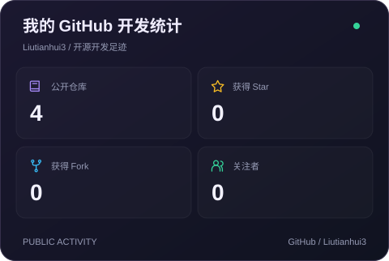
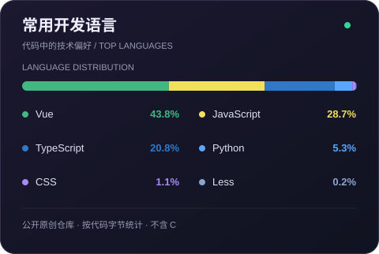

<!-- 平台链接占位：将各个 href 替换为你的个人主页地址。 -->
&ensp;
&ensp;
&ensp;
&ensp;

**技术，让世界变得更美好。**

 

&ensp;&ensp;

 

[技术栈](#技术栈) · [开发足迹](#开发足迹) · [最近在听](#最近在听)

---

### Hi! Nice to meet you！

- 👋 我是 **Liutianhui3**，一名 **全栈开发者**，目前生活在 **江苏 · 苏州**。
- 👀 我对前端交互、后端服务、数据库与 AI 应用开发感兴趣。
- 🌱 我正在探索 AI Agent、知识库检索增强与流式交互，让想法成为可以实际使用的产品。
- 💞️ 欢迎交流个人博客、AI 工作台与全栈项目，一起做有趣的作品。
- 📫 联系我：[GitHub](https://github.com/Liutianhui3) · [个人博客](http://101.200.81.48/login)。

## 技术栈

### 前端 · 页面与交互

              

### 后端 · 接口与服务

           

### 数据库 · 存储与检索

   

### 工具 · 开发与部署

           

## 开发足迹

<table width="100%">
  <tr>
    <td width="50%" align="center" valign="top">
      
    </td>
    <td width="50%" align="center" valign="top">
      
    </td>
  </tr>
</table>

 

## 最近在听

 
 

**认真写代码，也认真享受生活。**

