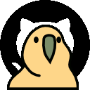
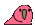
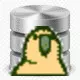
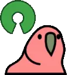
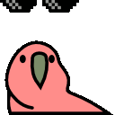

# 你好，我是Liutianhui3

### 用代码构建体验，让想法成为作品。

**Node.js 全栈开发 · 个人博客 · AI 工作台 · 知识库检索**

  

 

[项目作品](#项目作品) · [技术栈](#技术栈) · [开发足迹](#开发足迹) · [最近在听](#最近在听)

---

## 关于我

我是 **Liutianhui3**，一名 **Node.js 全栈开发者**，目前生活在 **江苏 · 苏州**。

喜欢把前端交互、后端服务与数据连接起来，做出可以实际使用的产品。代码之外，喜欢 **咖啡** 和 **足球**。

## 技术栈

### 前端 · 页面与交互

            

### 后端 · 接口与服务

    

### 数据库 · 存储与检索

  

### 工具 · 开发与部署

           

## 开发足迹

 

 

## 最近在听

 
 

**认真写代码，也认真享受生活。**

